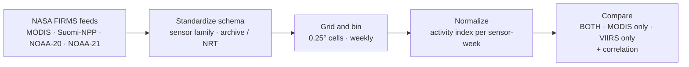

<div align="center">

# 🔥 FireTrace Pakistan

### Harmonizing 26 years of MODIS and VIIRS satellite fire detections

[](https://babarkd.pythonanywhere.com)
[](https://www.spaceappschallenge.org/)


**Team: Me, Myself & MODIS** · Babar Khan Durrani


</div>

---

## 🌍 The challenge

**Harmonization of MODIS and VIIRS Hot Spots.** MODIS has observed Pakistan since 2000 at roughly 1 km resolution. VIIRS adds a 375 m view from 2012. Their raw detection counts differ in resolution, coverage and operating periods, so putting the two side by side is misleading.

## 💡 Our approach

FireTrace places both sensor families on **one spatial grid and one timeline**, normalizes activity within each sensor, and measures where they agree and where they diverge.



| Step | What happens |
|---|---|
| **Ingest** | Four NASA FIRMS feeds (archive and near-real-time) are read into DuckDB |
| **Standardize** | One schema with a sensor-family label (MODIS or VIIRS) and data-stream tag |
| **Grid and bin** | Detections are aggregated to 0.25° cells and weekly intervals |
| **Normalize** | Each cell's detections per 100,000 detections of the same sensor family that week |
| **Compare** | Each cell-week is classified as seen by both sensors, MODIS only or VIIRS only, plus a Pearson correlation of relative activity |

## ✨ Features

| | |
|---|---|
| 🗺️ **Interactive map** | Pakistan fire activity on a 0.25° grid with date, sensor, satellite and stream filters |
| 🛰️ **Sensor comparison** | MODIS versus VIIRS monthly trends and per-satellite breakdown |
| 🧩 **Harmonization** | Cross-sensor agreement and correlation on the shared grid |
| 📅 **Seasonality** | Average monthly share of annual detections per sensor |
| 📍 **Persistence** | Locations active year after year, ranked, with a selectable Top 5 / 10 / 20 / 50 |
| 🔥 **Concentration** | Locations with the densest detections, ranked, with a selectable Top 5 / 10 / 20 / 50 |
| 🗓️ **Activity calendar** | Burning activity by month and year |
| ⬇️ **CSV export** | Download the harmonized weekly grid for any selected date range |

## 📸 Screenshots

| Map explorer | Harmonization |
|---|---|
|  |  |

| Persistence ranking | CSV export |
|---|---|
|  |  |

## 📦 Data

- **Source:** [NASA FIRMS](https://firms.modaps.eosdis.nasa.gov/) (Fire Information for Resource Management System)
- **Sensors:** MODIS (Terra, Aqua), VIIRS (Suomi-NPP, NOAA-20, NOAA-21)
- **Coverage:** 2000 to 2026, Pakistan
- This repository contains the processed DuckDB database (`data/processed/firetrace.duckdb`). Raw FIRMS downloads are not included.

## 🚀 Run locally

```bash
git clone https://github.com/BabarKhanD/firetrace-pakistan.git
cd firetrace-pakistan
pip install -r requirements.txt
python app/server.py
```

Then open http://127.0.0.1:5000

## 🔌 API

| Endpoint | Purpose |
|---|---|
| `/api/hotspots` | Grid-cell detection counts for the map |
| `/api/sensor-comparison` | MODIS versus VIIRS monthly and platform totals |
| `/api/harmonization` | Cross-sensor agreement summary and correlation |
| `/api/harmonization/download?start=YYYY-MM-DD&end=YYYY-MM-DD` | CSV of the harmonized weekly grid |
| `/api/seasonality` | Historical monthly share per sensor |
| `/api/persistence?limit=N` | Most persistent grid cells |
| `/api/concentration?limit=N` | Most concentrated grid cells |
| `/api/calendar` | Monthly activity by year |

## ⚠️ Limitations

- Counts are **satellite observations, not unique fires**. One fire can be detected several times or by several satellites.
- Agreement (`BOTH`) does not prove two sensors saw the same fire.
- Correlation measures similarity in **relative** spatial activity, not detection sensitivity or measurement equivalence.
- The harmonization chart on the page shows the full period. The CSV follows the selected dates.
- Research and decision-support prototype. Not an official early-warning service.

## 🙏 Acknowledgements

Built for the **NASA Space Apps Challenge 2026**. Fire data courtesy of NASA FIRMS. Map tiles by OpenStreetMap contributors. This project is not affiliated with or endorsed by NASA.

---

<div align="center">

**Team Me, Myself & MODIS** · Babar Khan Durrani

</div>
